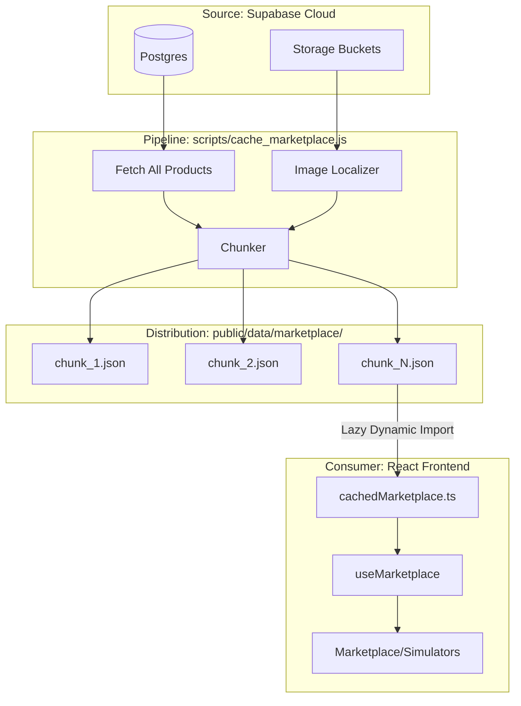

# SKHY AI - Technical Architecture & Data Lifecycle

This document serves as the technical source of truth for the SKHY AI platform, detailing the relationship between hardware simulation, marketplace data, and mission-critical control flows.

---

## 1. Universal Data Pipeline (The "Chunking" Pattern)

To maintain sub-second load times while handling thousands of industrial products, SKHY uses a build-time ETL (Extract, Transform, Load) process.



### Key Technical Details:
- **Atomicity**: Chunks are limited to 12 items to ensure minimal JS execution during marketplace scrolls.
- **Image Resilience**: The `Image Localizer` downloads remote assets to `public/images/marketplace/` during build, preventing 404s from upstream supplier outages.
- **Reference Index**: `src/data/cachedMarketplace.ts` acts as the manifest for all chunks.

---

## 2. Mission Architect Wizard (Control Flow)

The `ScenarioPlanner.tsx` has been evolved from a simple selector into a **Guided Mission Architect**. This wizard synchronizes hardware constraints with tactical requirements.

### The 4-Step Architect Flow:

| Step | Component | Responsibility |
| :--- | :--- | :--- |
| **1. System Profile** | `ProfileSelector.tsx` | Defines the platform type (UAV, UGV, USV) and base airframe/chassis class. |
| **2. Region & Governance** | `GovernanceLayer.tsx` | Filters products based on Country of Origin (e.g., Non-China, ITAR Free) and local RF regulations. |
| **3. Tactical Requirements** | `TacticalSim.tsx` | Physics-based simulation (Jamming Resilience, Payload/Range stress tests). |
| **4. Smart BOM Selection** | `BOMArchitect.tsx` | Final component selection with "Smart Swap" logic for similar products. |

---

## 3. Simulator Bridging (React vs. HTML)

SKHY supports two types of simulators: **Native React** (high integration) and **Isolated HTML/Three.js** (legacy/complex physics).

### A. Native React Simulators (`RFJammerSimulator`, `HeavyLiftSimulator`)
- **State Management**: Shared via `useSimulationState` hooks.
- **Cart Integration**: Direct access to `CartContext.addToCart`.
- **UI**: Uses Tailwind + Framer Motion for premium feel.

### B. Isolated HTML Simulators (`skhy-rover-using-skhy-edge.html`)
- **Isolation**: Runs in an `<iframe>` to prevent Three.js main-thread blocking.
- **Bridge**: Communicates via `window.postMessage`.

#### The `postMessage` Protocol:
```json
{
  "type": "SKHY_ROVER_BOM_TRIGGER",
  "payload": {
    "edgeType": "skhy_resilient",
    "rfWatts": 20,
    "relayType": "ground"
  }
}
```

---

## 4. Persistent Cart & "Virtual Products"

A critical architectural challenge is persisting items that exist **only in the simulator** (Transient Items).

- **Standard Items**: Mapped directly to Supabase `product_id`.
- **Transient Items**: Assigned a `local_` UUID prefix.
- **Persistence Logic**:
    1.  `CartContext` serializes the cart to `localStorage`.
    2.  During remote sync, `local_` items are **skipped** for database persistence (to avoid FK errors) but **retained** in the client-side state.
    3.  `CartContext.enrichFromCache` attempts to find metadata for these items from the local marketplace cache.

---

## 5. Dynamic Wiring Engine (Proposed)

To solve the explosion of 200+ static `.mmd` files, SKHY is migrating to a **Template-Based Mermaid Generation Engine**.

- **System Templates**: `src/data/mermaid/templates/quad_standard.ts`
- **Logic**: The engine takes a BOM (List of Product IDs) and wires them together based on their `category` and `sub_category`.
- **Output**: Generates a Mermaid source string at runtime, rendered by the `Mermaid` React component.

---

## 7. Global Commerce & Role-Based Workflows

SKHY AI operates as a multi-sided marketplace platform with distinct lifecycles for each user role.

### A. Admin Console (The "Control Tower")
The Admin Panel (`src/pages/admin/`) manages the global platform state.
- **System Settings (`AdminSettings.tsx`)**: High-level toggles for Maintenance Mode, Landing Page sections, and critical API Keys (Wise, Stripe, Easyship).
- **Marketplace Governance**: `ProductApproval.tsx` allows admins to verify technical specifications of supplier-uploaded components before they enter the public catalog. 
  *(See [Marketplace Product Flags](../marketplace/PRODUCT_CATALOG_FLAGS.md) for details on `is_active`, `show_on_marketplace`, and other visibility controls).*
- **Seller Management**: `PartnerManagement.tsx` handles the status and performance tracking of the 110+ manufacturers.

### B. Partner Lifecycle (Suppliers)
The onboarding and management flow for hardware partners (`src/pages/partner/`).
1.  **Onboarding**: `PartnerOnboarding.tsx` collects KYC, business documentation, and shipping preferences.
2.  **Product Hub**: `ProductForm.tsx` supports detailed technical mapping (specifications, weights, power draw).
3.  **Financials**: `PayoutSettings.tsx` integrates with **Wise** and **Airwallex** for cross-border settlements.

### C. Buyer Experience (Customers)
The core user journey focuses on mission-driven procurement (`src/pages/buyer/`).
- **Guided Onboarding**: `CustomerRegister.tsx` captures tactical interests to personalize the Mission Architect recommendations.
- **Order Tracking**: Real-time status updates from procurement through international fulfillment via **Easyship**.

---

## 8. Multi-Protocol Payment Engine

To handle global defense hardware transactions, SKHY uses a dynamic payment routing system.

| Method | Use Case | Implementation |
| :--- | :--- | :--- |
| **Stripe** | Standard Credit/Debit Cards | `PaymentForm.tsx` (Elements integration) |
| **Wise (Transfer)** | High-value B2B bank transfers | `PartnerPaymentSetup.tsx` (SWIFT/IBAN) |
| **USDC (Crypto)** | Strategic/Restricted region payments | `CryptoCheckout.tsx` (Manual TXID verification) |

### Financial Logic:
- **Currency Normalization**: Internal pricing is handled in USD. Manufacturer prices (e.g., INR) are converted at a 1/91.0 rate.
- **Commission Management**: A standard **3.8% platform fee** is applied to all marketplace transactions to cover liability and discovery costs.

---

## 9. Resource Integrity & Cleanup

To prevent "asset rot," `scripts/cleanup_resources.js` acts as a garbage collector. It cross-references:
1.  `wiringIndex.ts` vs `public/mermaid/*.mmd`
2.  `cachedMarketplace.ts` vs `public/images/marketplace/*`

Any asset not referenced in the active codebase or marketplace manifests is automatically purged.

---

## 10. Compliance & Document Generation

For partner onboarding and sensitive product access, SKHY employs a localized document generation workflow.

### The NDA & Agreement Flow:
1. **Digital Signature Capture**: Users sign via a responsive Canvas component (`react-signature-canvas`).
2. **Client-Side Rendering**: Using `jspdf` and `html2canvas`, the legal text and the Base64 signature are composited into a standard PDF entirely within the browser.
3. **Secure Storage**: The generated PDF is uploaded directly to a private Supabase Storage bucket (`nda_agreements`).
4. **Database Record**: A pointer to the storage bucket, along with user metadata, is saved in the `ndas` table, leveraging RLS to ensure only authorized admins can access the document.

---

## 11. Real-time Geographic Analytics

To understand buyer intent and enforce regional access controls (e.g., restricted domains), SKHY implements a dual-layer geographic tracking system.

- **Edge Resolution**: Identifies visitor IPs and resolves geographic coordinates (latitude/longitude) and region codes.
- **Hook Integration (`useVisitorTracking`)**: A custom React hook that runs on initial load, securely pushing the visitor footprint to the `site_visitors` Supabase table.
- **Admin Visualization**: The `SiteAnalytics` dashboard consumes this data, mapping interactions globally to indicate emerging demand centers in real-time.
